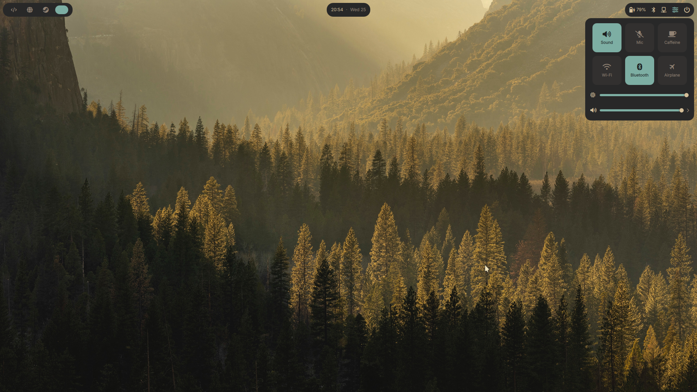

# quill

A Quickshell-based desktop shell for the [niri](https://github.com/YaLTeR/niri)
Wayland compositor: a status bar with a control center, system popups and a
notification daemon, themed Gruvbox Material.



## Features

- **Bar:** niri workspaces with app-aware icons, clock and calendar, system
  tray (StatusNotifierItem host with themed context menus), and quick status
  icons. Click any bar icon to jump straight from one popup to another.
- **Control center:** Wi-Fi, Bluetooth, airplane mode, caffeine (idle
  inhibitor) and do-not-disturb toggles; brightness and volume sliders;
  mic mute.
- **Network hub:** wired and Wi-Fi in one place (scan, connect, passwords,
  details, forget), plus VPN status and connect/disconnect for
  NetworkManager VPN profiles.
- **Airplane mode** that remembers which radios you kept on, with an IPC
  toggle for a key bind.
- **Bluetooth:** device list, pairing, connect/disconnect.
- **Battery and power:** battery details, power profiles, and a fullscreen
  power menu (sleep, restart, shut down, log out) with keyboard shortcuts.
- **Per-app volume mixer:** one card per app, per-tab/stream sliders, mute
  buttons, and two layouts (`cards` or compact `rows`).
- **Notification daemon:** popup cards with a countdown, actions, duplicate
  collapsing and do-not-disturb (with a bar indicator).
- Event-driven services (D-Bus, udev, NetworkManager, PipeWire) — no polling
  loops.

## Requirements

- niri, [Quickshell](https://quickshell.org) 0.3.2, Qt 6 (`qt6-declarative`
  tools for tests and lint)
- NetworkManager (`nmcli`), BlueZ (`bluetoothctl`), UPower,
  power-profiles-daemon, PipeWire
- `brightnessctl` and `udevadm` for the brightness slider (the first device
  under `/sys/class/backlight` is used); `loginctl` and `swaylock` for the
  power menu; `swww` + ImageMagick (`magick`) for the power menu's blurred
  backdrop (optional); `busctl` to detect another notification daemon
- A [Nerd Font](https://www.nerdfonts.com) for glyphs
- CMake and a C++ toolchain to build the niri IPC plugin

## Install & run

```sh
git clone --recursive https://github.com/flohrel/quill.git
cd quill
make plugin        # builds vendor/qml-niri into build/qml/Niri
./quill-launch.sh  # run it
```

Autostart from your niri config:

```kdl
spawn-at-startup "/path/to/quill/quill-launch.sh"
```

Useful niri binds (quill exposes these over Quickshell IPC). Avoid binding
airplane mode to a laptop's own Wi-Fi key (`XF86WLAN`): with
`CONFIG_RFKILL_INPUT=y` the kernel toggles Wi-Fi on that key too, so it would
act twice.

```kdl
binds {
    Mod+Shift+A { spawn "qs" "ipc" "-p" "/path/to/quill" "call" "airplane" "toggle"; }
    Mod+N    { spawn "qs" "ipc" "-p" "/path/to/quill" "call" "notifications" "toggleDnd"; }
}
```

quill becomes your notification daemon when `org.freedesktop.Notifications`
is free. If another daemon already owns it, quill leaves it alone and logs a
warning; set `notifications.enabled: false` in `config/Config.qml` to turn
quill's daemon off.

## Configuration

Everything lives in [`config/Config.qml`](config/Config.qml): geometry,
timeouts, and options such as `mixer.layout` (`"cards"` | `"rows"`),
`notifications.countdown` (`"bar"` | `"border"` | `"none"`), workspace
glyphs and tray click routing. Colors are in
[`config/GruvboxMaterial.qml`](config/GruvboxMaterial.qml). Edit, and
Quickshell hot-reloads.

## Architecture

Three layers, deliberately separated:

- `bar/` — presentation: the panel, pills, popup overlays and notification
  cards.
- `services/` — system integration: QML singletons wrapping NetworkManager,
  UPower, BlueZ, PipeWire and niri IPC, with pure-logic `.js` helpers.
- `tests/` — QtTest suites over the pure layer. Because logic lives in plain
  QML/JS and Quickshell/niri are quarantined at the edges
  (`services/NiriService.qml` is the only file importing the niri plugin),
  the suite runs headless in milliseconds — locally and
  [in CI](.github/workflows/ci.yml) — without a compositor.

## Development

```sh
make test                    # all QtTest suites (any failure fails the run)
make lint                    # qmllint over tracked QML
./quill-test.sh 120          # fused launcher for risky live tests
```

Hard-won platform notes (NetworkManager property bounce, BlueZ pairing without
an agent, Nerd Font glyph handling, safe live-testing of a shell that owns
your screen) are in [CLAUDE.md](CLAUDE.md). Changes land through pull
requests; see [CHANGELOG.md](CHANGELOG.md) for releases.

## License

[MIT](LICENSE)
